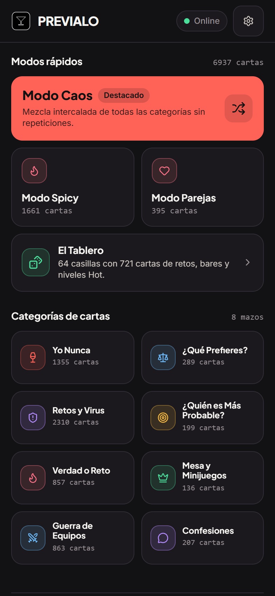
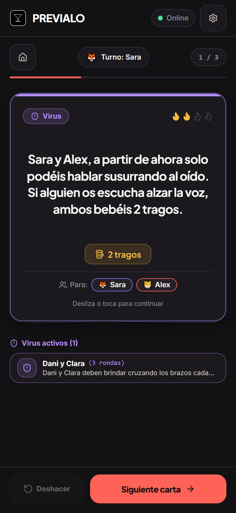

<div align="center">

# 🍻🎲 PREVIALO

**Aplicación web progresiva de juegos de previa y mesa compartida para jugar en grupo sin anuncios ni conexión.**

_Un único móvil en el centro de la mesa con más de 6.900 cartas, reglas temporales activas y un tablero de 64 casillas con dado interactivo._

<p align="center">
  
  
  
  
  
  
  
  
  
</p>

</div>

---

Improvisar una partida en una reunión suele tropezar con los mismos obstáculos: aplicaciones llenas de anuncios entre turnos, mazos bloqueados tras suscripciones semanales, cartas repetidas al cabo de diez minutos o fallos en cuanto se pierde la cobertura en un sótano, una casa rural o la playa.

Previalo resuelve todo eso en una sola pantalla compartida bajo el modelo pass-and-play. Cada grupo abre la aplicación, añade los nombres de quienes están sentados a la mesa y empieza a jugar al instante con un catálogo completo guardado en el propio dispositivo, sin registros, sin servidores externos y con control total sobre la intensidad de la partida.

---

## 📱 Vista previa de la aplicación

<p align="center">
  
  
  
  
</p>

La interfaz se organiza en cuatro vistas principales:

1. **Inicio y catálogo**: Reúne en la parte superior los cuatro accesos directos de la noche (Modo Caos, Modo Spicy, Modo Parejas y El Tablero) y despliega debajo las ocho categorías de cartas en una cuadrícula simétrica con el conteo real de cada mazo.
2. **Configuración de sala**: Permite ajustar los niveles de intensidad, activar o desactivar packs temáticos según el modo elegido, añadir jugadores manualmente o con un toque desde el historial reciente y lanzar la partida desde el botón inferior fijo.
3. **Partida de cartas**: Muestra cada carta con su tipo, intensidad, destinatarios y tragos calculados, mantiene visibles las reglas temporales activas en el panel inferior y fija los botones de deshacer y avanzar siempre al alcance del pulgar.
4. **El Tablero**: Presenta el recorrido serpentino de 64 casillas agrupadas en cuatro familias visuales claras, señala el turno y la casilla actual del jugador activo y sitúa el dado táctil junto al botón de lanzamiento en una barra inferior compacta.

---

## ⚙️ Cómo funciona Previalo

### 1. Elección del modo y ajuste de la sala

Antes de repartir la primera carta, el grupo decide qué ritmo quiere para la noche desde la pantalla principal o directamente mediante accesos directos en la pantalla de inicio del teléfono:

* **Modos rápidos**: Modo Caos mezcla todas las categorías en una sola baraja variada; Modo Spicy reúne más de 1.600 cartas picantes graduadas en tres niveles; Modo Parejas agrupa dinámicas cómplices; y El Tablero abre el juego de mesa interactivo de 64 casillas.
* **Ocho categorías independientes**: Yo Nunca, ¿Qué Prefieres?, Retos y Virus, ¿Quién es Más Probable?, Verdad o Reto, Mesa y Minijuegos, Guerra de Equipos y Confesiones.
* **Filtros reactivos**: En la sala previa se eligen los niveles de intensidad (Chill, Fiesta, Hot y Extremo) y los packs compatibles se filtran al instante para evitar combinaciones vacías. Por ejemplo, en Verdad o Reto se puede jugar solo con verdades, solo con retos o mezclar ambos y acotar qué niveles picantes entran en el mazo.

### 2. Reparto justo de turnos y variedad en el mazo

Durante una partida larga con varios amigos es habitual que los sorteos ingenuos repitan al mismo jugador tres turnos seguidos o encadenen cinco cartas del mismo tipo. Previalo corrige ambos problemas de forma automática:

1. **Alternancia equilibrada de participantes**: Cada vez que una carta necesita nombrar a uno o varios jugadores, el reparto da prioridad a quienes han salido menos veces recientemente y garantiza que nunca se asigne a la misma persona dos veces en la misma frase. Si juegan Alex, Sara, Dani y Clara durante una hora, todos reciben un número similar de retos.
2. **Ritmo variado en Modo Caos**: Al mezclar categorías distintas, la baraja evita rachas monótonas limitando a un máximo de tres cartas seguidas procedentes de la misma categoría y excluyendo pruebas pensadas exclusivamente para equipos.
3. **Concordancia natural en español**: Cuando una carta involucra a más de un jugador, los nombres se enlazan correctamente en español y se adaptan las referencias de tragos en singular o plural.

### 3. Virus temporales, cartas de cura y retroceso seguro

Las reglas temporales convierten una partida normal en un hilo continuo de risas cruzadas. Cuando sale una carta de virus, por ejemplo una regla que obliga a Sara y Alex a hablar susurrando durante varias rondas, la regla queda registrada en el panel de virus activos bajo la carta. Tocar esa pastilla abre el texto completo sin perder el turno actual, indicando a quién afecta y cuántas rondas faltan o si permanece activa hasta que aparezca su carta de cura.

Las cartas de cura y las continuaciones inmediatas se programan automáticamente unas rondas después de su carta de origen, nunca antes. Si alguien avanza una carta por error y pulsa *Deshacer*, la aplicación restaura el turno anterior, revierte el contador de rondas de cada virus y retira del mazo cualquier carta de cura que ese turno hubiera programado.

### 4. El Tablero de 64 casillas y dado interactivo

El Tablero adapta el clásico recorrido de mesa a tres modalidades configurables antes de empezar: Clásica, Hot (con selección de niveles 1, 2 y 3 que suben progresivamente según el tramo del tablero) y Todos.

* **Cuatro familias visuales de casillas**: Salida y meta, acciones y dinámicas de grupo, tragos y saltos *De bar en bar*, y trampas como la cárcel, retrocesos o vuelta a la casilla 1.
* **Reglas de avance exactas**: Si un jugador está en la casilla 62 y saca un 5 en el dado, avanza hasta la 64 y rebota tres casillas hacia atrás hasta la 61. Al caer en la cárcel, el siguiente turno se salta automáticamente con un aviso claro y el icono de candado permanece sobre su ficha hasta cumplir la penalización.

---

## 💾 Privacidad, uso sin conexión y diseño móvil

Previalo funciona al 100% en el dispositivo del usuario. No existen cuentas, bases de datos remotas, rastreadores de analítica ni redes publicitarias.

* **Persistencia local inmediata**: Las preferencias, el historial de jugadores frecuentes y la partida en curso se guardan al instante en el navegador. El catálogo de cartas y tableros se almacena en IndexedDB y comprueba su integridad criptográfica SHA-256 frente al manifiesto para actualizarse solo cuando hay cambios reales.
* **Instalable como aplicación nativa (PWA)**: Mediante Service Worker y Workbox, el código, las tipografías y los catálogos quedan precacheados para abrirse en modo pantalla completa en iOS y Android sin conexión. Si se bloquea el móvil en mitad de la noche, al desbloquearlo la partida sigue exactamente en la misma carta o casilla.
* **Diseño visual y temas mate**: La interfaz adopta una estética de baraja nocturna moderna con superficies mate de alto contraste, tipografía Plus Jakarta Sans para títulos y cartas junto a Inter para controles (ambas empaquetadas localmente), iconos vectoriales uniformes sin emojis decorativos en la interfaz y cinco temas seleccionables en Ajustes: Noche Coral, Obsidiana Índigo, Bosque Esmeralda, Ámbar Nocturno y Modo Día.
* **Ergonomía táctil y respuesta sensorial**: Todos los controles cumplen un área táctil mínima de 44×44 px, los botones primarios de Configuración, Cartas y El Tablero permanecen fijados en la zona inferior del pulgar respetando las áreas seguras de iOS, y los efectos de sonido se sintetizan en tiempo real con Web Audio API junto a vibración háptica opcional.

---

## 🏛️ Arquitectura y estructura del proyecto

El código fuente está escrito en **TypeScript estricto** siguiendo Clean Architecture en cuatro capas desacopladas para aislar la lógica de juego de la interfaz y facilitar las pruebas automatizadas:

1. **Capa de dominio puro (`src/domain/`)**: Contiene los motores deterministas y estadísticos sin dependencias de React ni del navegador (`CardEngine.ts`, `VariableReplacer.ts`, `VirusManager.ts`, `BoardEngine.ts`) junto a sus contratos de tipos (`src/domain/types/`).
2. **Capa de aplicación (`src/application/`)**: Orquesta las sesiones, los jugadores y las preferencias mediante stores de Zustand con persistencia local (`useGameSessionStore.ts`, `usePlayerStore.ts`, `useSettingsStore.ts`).
3. **Capa de infraestructura (`src/infrastructure/`)**: Encapsula la carga offline con caché en IndexedDB y validación SHA-256 (`catalogLoader.ts`), la síntesis de audio procedural (`soundService.ts`), el registro del Service Worker (`registerSW.ts`) y las notificaciones locales (`notificationService.ts`).
4. **Capa de presentación (`src/presentation/`)**: Implementa las cuatro pantallas principales (`HomeScreen.tsx`, `SetupScreen.tsx`, `GameCardsScreen.tsx`, `GameBoardScreen.tsx`), los componentes táctiles y modales (`SwipeableCard.tsx`, `CardDeck.tsx`, `BoardGrid.tsx`, `Dice3D.tsx`, `VirusHUD.tsx`, `SettingsModal.tsx`, `TopHeader.tsx`), los hooks de desplazamiento (`useDragToScroll.ts`) y los tokens semánticos documentados en `DESIGN.md`.

```text
previalo-project/
├── DESIGN.md                     # Fuente de verdad del sistema de diseño y tokens mate
├── docs/
│   └── screenshots/              # Capturas móviles Retina 2x para la documentación
│       ├── 01-home-screen.png    # Pantalla principal con modos rápidos y 8 categorías
│       ├── 02-setup-screen.png   # Sala previa con filtros de intensidad y jugadores
│       ├── 03-game-cards.png     # Partida de cartas activa con panel de virus
│       └── 04-game-board.png     # El Tablero de 64 casillas y dock de dado
├── public/
│   ├── data/                     # Catálogo JSON oficial particionado por categorías y presets
│   │   ├── by_category/          # Mazos temáticos y definición de tableros
│   │   ├── presets/              # Colecciones rápidas (Modo Spicy, Modo Parejas)
│   │   └── catalog_manifest.json # Manifiesto de versiones y hashes SHA-256
│   ├── icons/                    # Iconografía PWA adaptable y maskable
│   └── favicon.svg               # Isotipo oficial de la marca
├── scripts/
│   ├── generate_screenshots.mjs  # Pipeline automatizado de capturas con Puppeteer
│   └── sync_production_data.py   # Sincronización y recálculo de hashes del catálogo
├── src/
│   ├── application/              # Stores Zustand (sesión, jugadores y ajustes de tema)
│   ├── domain/                   # Motores de cartas, equidad, virus y tablero (0 DOM)
│   ├── infrastructure/           # Caché IndexedDB, Web Audio API y gestión PWA
│   ├── presentation/             # Pantallas, componentes táctiles, hooks y estilos
│   ├── App.tsx                   # Coordinador SPA, shortcuts y sincronización de tema
│   ├── index.css                 # Tokens semánticos Tailwind v4 y viewport pinning iOS
│   └── main.tsx                  # Punto de entrada de React 19 y fuentes locales
├── tests/                        # Suites E2E y pruebas adversariales (584 tests totales)
├── package.json                  # Dependencias y scripts de desarrollo
├── tsconfig.json                 # Configuración estricta de TypeScript
└── vite.config.ts                # Configuración de Vite 6, Tailwind v4 y Workbox PWA
```

---

## 🚀 Instalación y puesta en marcha

### Requisitos previos

* **Node.js**: Versión `20.18.0` o superior (recomendado v22).
* **npm**: Versión `10.0.0` o superior.
* **Variables de entorno**: No requiere archivo `.env` ni claves externas; la aplicación funciona completamente en local.

### Pasos rápidos

```bash
# 1. Clonar el repositorio
git clone https://github.com/tu-usuario/previalo.git
cd previalo

# 2. Instalar las dependencias
npm install

# 3. Iniciar el servidor de desarrollo en http://localhost:5173
npm run dev

# 4. Compilar para producción (incluye Service Worker y fuentes offline)
npm run build

# 5. Ejecutar la suite completa de pruebas automatizadas
npm test
```

### Scripts disponibles

| Comando | Descripción |
|---|---|
| `npm run dev` | Levanta el entorno de desarrollo local con Vite en `http://localhost:5173`. |
| `npm run build` | Comprueba el tipado de TypeScript y genera la compilación optimizada PWA en `dist/`. |
| `npm run preview` | Sirve en local la compilación de producción para probar la instalación PWA y el modo offline. |
| `npm run typecheck` | Ejecuta la comprobación estricta de tipos TypeScript sin emitir archivos. |
| `npm test` | Ejecuta las 53 suites de pruebas unitarias, de presentación, integración y adversariales en Vitest. |
| `npm run test:e2e` | Ejecuta específicamente los escenarios End-to-End de partidas de cartas, virus, tablero y temas. |
| `npm run screenshots` | Arranca el pipeline con Vite y Puppeteer para regenerar las 4 capturas móviles Retina 2x en `docs/screenshots/`. |
| `npm run sync:data` | Sincroniza los archivos del catálogo y recalcula sus hashes SHA-256 en el manifiesto. |

---

## 📄 Licencia

Este proyecto se distribuye bajo la Licencia **MIT**. Consulta el archivo `LICENSE` para más información.
