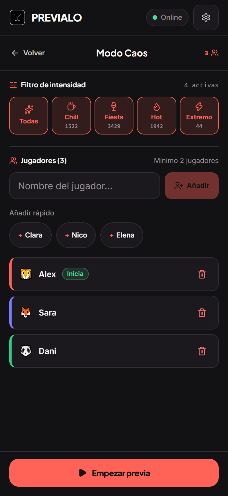
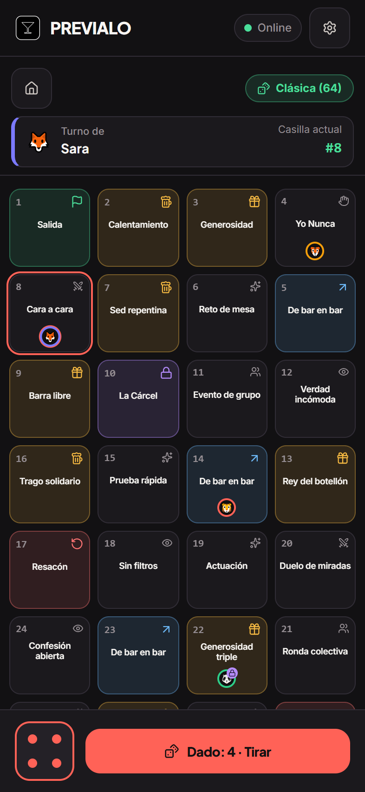
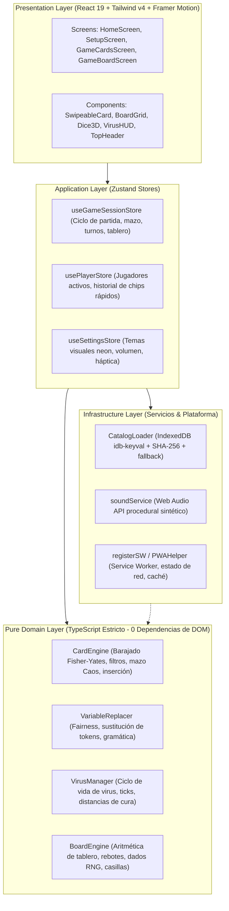

<div align="center">

# 🍻🎲 PREVIALO

**La Progressive Web App definitiva de entretenimiento social y juegos de previa en grupo.**

_Pass-and-Play en dispositivo único compartido: más de 6.900 tarjetas interactivas, modo tablero con dados 3D y reglas temporales persistentes, 100% offline y sin anuncios._

<p align="center">
  
  
  
  
  
  
  
  
  
</p>

</div>

---

## 📱 Vista Previa de la Aplicación

<p align="center">
  
  
  
  
</p>

<p align="center">
  <sub><strong>1. Menú Principal & Catálogo</strong> &nbsp;&bull;&nbsp; <strong>2. Configuración de Sala</strong> &nbsp;&bull;&nbsp; <strong>3. Partida con Virus HUD</strong> &nbsp;&bull;&nbsp; <strong>4. El Tablero & Dados 3D</strong></sub>
</p>

---

## 🌟 Características Principales

**Previalo** está concebido bajo el modelo **Pass-and-Play** (un único teléfono o tablet en el centro de la mesa que circula entre los participantes). Toda la lógica de turnos, distribución de protagonismo, penalizaciones y resolución de reglas temporales se ejecuta en tiempo real en el cliente.

### 🃏 Dinámicas de Juego y Modos de Fiesta

- **Catálogo Unificado (+6.900 Tarjetas)**: 8 categorías temáticas completas (_Yo Nunca_, _¿Qué Prefieres?_, _Quién es Más Probable_, _Verdad o Reto_, _Retos y Virus_, _Guerra de Equipos_, _Confesiones_, _Mesa y Minijuegos_).
- **Modo Caos (Intercalado Balanceado)**: Algoritmo de barajado con cota matemática de no-monotonía que garantiza un máximo estricto de $\le 3$ tarjetas consecutivas de la misma categoría.
- **Motor de Equidad (`VariableReplacer`)**:
  - Balanceo de protagonismo controlado por varianza (desviación máxima $\le 15\%$ respecto a la distribución uniforme en 500 robos).
  - Garantía de unicidad entre participantes (`{player1}` y `{player2}` nunca se asignan a la misma persona).
  - Adaptación sintáctica y flexión gramatical automática en español.
- **Sistema de Virus y Maldiciones Temporales (`VirusManager`)**:
  - Tarjetas clasificadas como _Virus_ que imponen reglas persistentes durante $N$ rondas.
  - Indicador persistente en pantalla (**Virus HUD**) con seguimiento visual del contador de rondas y participantes afectados.
  - Mecánica de cartas de curación enlazadas (_Resolvers/Cures_) con inyección programada y retroceso seguro (_Undo_).
- **El Tablero Interactivo**:
  - Recorrido circular y lineal de 45 casillas tematizadas con casillas especiales, de salto y de penalización.
  - Simulación física y matemática de **Dado 3D** con distribución uniforme verificada mediante pruebas de bondad de ajuste Chi-Cuadrado ($\chi^2$).
  - Aritmética de rebote exacto en meta y estado de inmovilización en cárcel con suspensión de turnos.
- **Síntesis de Audio Procedural (`Web Audio API`)**:
  - Efectos sonoros generados algorítmicamente mediante osciladores y filtros en tiempo real (lanzamiento de dados, clics táctiles, alertas de virus, victoria), sin retardos ni descargas de ficheros de audio externos.

---

## ⚡ Capacidades PWA y Resiliencia Offline-First

Previalo cumple con los estándares más estrictos de aplicaciones web progresivas autónomas, con especial foco en WebKit iOS Standalone y navegadores móviles modernos:

| Capacidad                             | Implementación Técnica                                                                                           | Beneficio para el Usuario                                                                                                                              |
| ------------------------------------- | ---------------------------------------------------------------------------------------------------------------- | ------------------------------------------------------------------------------------------------------------------------------------------------------ |
| **Instalación Nativa PWA**            | Web App Manifest con modo `display: standalone`, orientación `portrait-primary` e iconos adaptativos / maskable. | Se instala directamente desde Safari ("Añadir a pantalla de inicio") o Chrome ("Instalar App") comportándose como app nativa sin barras de navegación. |
| **Persistencia 100% Offline**         | Service Worker con Workbox y almacenamiento dual IndexedDB (`idb-keyval`) + `localStorage`.                      | El catálogo completo de datos y motores funciona sin cobertura ni acceso a internet en cualquier lugar.                                                |
| **Integridad Criptográfica**          | Verificación SHA-256 automática en `catalog_manifest.json` y estrategia `NetworkFirst` con fallback a caché.     | Detección determinista de catálogos modificados e invalidación instantánea ante actualizaciones de contenido.                                          |
| **Tolerancia a Bloqueos de Pantalla** | Sincronización continua de estado en `useGameSessionStore` ante eventos `visibilitychange` y `pageshow`.         | Si el móvil se bloquea o la app pasa a segundo plano, la partida se restaura exactamente en el turno, carta y posición en que quedó.                   |
| **Viewport Pinning en iOS**           | Contenedor raíz anclado con `position: fixed; inset: 0` y compensación `env(safe-area-inset-top)` / `bottom: 0`. | Cero desalineaciones por notch o Dynamic Island, sin rebote elástico accidental y con 44x44px mínimos de área táctil.                                  |

---

## 🏛️ Arquitectura del Sistema

El proyecto sigue los principios de **Clean Architecture**, aislando estrictamente la lógica matemática de juego del estado de aplicación y los componentes de interfaz:



### Separación de Responsabilidades

| Capa               | Directorio            | Responsabilidad Principal                                                                                 | Regla de Oro                                                                             |
| ------------------ | --------------------- | --------------------------------------------------------------------------------------------------------- | ---------------------------------------------------------------------------------------- |
| **Domain**         | `src/domain/`         | Motores matemáticos (`CardEngine`, `VariableReplacer`, `VirusManager`, `BoardEngine`) y modelos de tipos. | **Cero dependencias** de React, DOM, `window`, `document` o librerías UI.                |
| **Application**    | `src/application/`    | Stores reactivos Zustand (`useGameSessionStore`, `usePlayerStore`, `useSettingsStore`).                   | Orquesta transiciones de juego y serialización sin contener reglas de negocio directas.  |
| **Infrastructure** | `src/infrastructure/` | Carga de catálogo con IDB, síntesis de audio procedural y registro del Service Worker.                    | Encapsula el acceso al hardware y almacenamiento del navegador.                          |
| **Presentation**   | `src/presentation/`   | Vistas (`screens/`), componentes (`components/`), hooks y estilos CSS.                                    | **Solo renderizado visual** y captura de eventos táctiles. Delegación estricta a stores. |

---

## 🚀 Instalación y Despliegue Rápido

### Requisitos Previos

- **Node.js**: Versión `>= 20.18.0` (recomendado v22 o superior).
- **npm**: Versión `>= 10.0.0`.
- **Navegador**: Safari (iOS 16+), Chrome, Edge o Firefox con soporte para PWA y Web Audio.

### Variables de Entorno

- **Zero Config**: La aplicación es 100% autónoma y client-side. No requiere variables de entorno (`.env`) ni tokens de autenticación para su compilación o ejecución en local ni en producción.

### Paso a Paso

```bash
# 1. Clonar el repositorio
git clone https://github.com/tu-usuario/previalo.git
cd previalo

# 2. Instalar dependencias del proyecto
npm install

# 3. Iniciar el entorno de desarrollo local (Vite)
npm run dev
```

La aplicación responderá inmediatamente en `http://localhost:5173`.

### Comandos Disponibles en `package.json`

| Comando               | Descripción                                                                                                                                                            |
| --------------------- | ---------------------------------------------------------------------------------------------------------------------------------------------------------------------- |
| `npm run dev`         | Inicia el servidor de desarrollo de Vite con recarga instantánea HMR.                                                                                                  |
| `npm run build`       | Ejecuta la comprobación TypeScript (`tsc -b`) y compila los bundles optimizados con el Service Worker en `dist/`.                                                      |
| `npm run preview`     | Previsualiza en local la compilación de producción con soporte offline.                                                                                                |
| `npm run typecheck`   | Comprobación estricta de tipos TypeScript sin emitir código (`tsc -b --noEmit`).                                                                                       |
| `npm test`            | Ejecuta la suite completa de pruebas unitarias, de integración y adversariales en Vitest (+580 tests).                                                                 |
| `npm run test:e2e`    | Ejecuta las pruebas End-to-End sobre el flujo completo de partida y robo secuencial.                                                                                   |
| `npm run screenshots` | **Pipeline automatizado**: levanta Vite y DeviceFrame Pro, captura las 4 pantallas principales enmarcadas en un **iPhone 15 Pro** y las valida en `docs/screenshots/`. |
| `npm run sync:data`   | Sincroniza y recalcula hashes criptográficos SHA-256 de los catálogos en `public/data/`.                                                                               |

---

## 📁 Estructura del Repositorio

```
previalo-project/
├── .agents/                      # Reglas de contexto y gobernanza arquitectónica
│   └── rules/                    # Invariantes de dominio, iOS viewport, state y testing
├── docs/
│   └── screenshots/              # Capturas oficiales de la PWA enmarcadas en iPhone
│       ├── 01-home-screen.png    # Menú principal y catálogo de categorías
│       ├── 02-setup-screen.png   # Configuración de sala, avatares y filtros
│       ├── 03-game-cards.png     # Partida de cartas activa con Virus HUD
│       └── 04-game-board.png     # Modo tablero con dados 3D y casillas
├── public/
│   ├── data/                     # Catálogo JSON oficial particionado por categorías y tableros
│   │   ├── by_category/          # Ficheros modulares (01_yo_nunca.json, 04_retos_y_virus.json...)
│   │   ├── presets/              # Presets preconfigurados (modo_caliente.json...)
│   │   └── catalog_manifest.json # Manifiesto con metadatos, versiones y hashes SHA-256
│   ├── icons/                    # Iconografía PWA adaptable y maskable para iOS y Android
│   └── favicon.svg               # Identidad visual de la marca
├── scripts/
│   ├── generate_screenshots.mjs  # Generador automatizado de capturas enmarcadas en iPhone
│   └── sync_production_data.py   # Script de sincronización e integridad de catálogo
├── src/
│   ├── application/              # Capa de Aplicación (Stores Zustand y gestión de sesiones)
│   │   ├── useGameSessionStore.ts# Store del bucle de juego, historial Undo y persistencia
│   │   ├── usePlayerStore.ts     # Store de participantes activos y chips rápidos
│   │   └── useSettingsStore.ts   # Store de preferencias visuales, háptica y temas
│   ├── domain/                   # Capa de Dominio Puro (0 dependencias externas)
│   │   ├── engines/              # CardEngine, VariableReplacer, VirusManager, BoardEngine
│   │   └── types/                # Contratos TypeScript de cartas, virus, tableros y sesiones
│   ├── infrastructure/           # Capa de Infraestructura (Navegador y almacenamiento)
│   │   ├── catalogLoader.ts      # Cargador de datos con caché IDB y verificación hash
│   │   ├── registerSW.ts         # Registro y gestión de ciclo de vida del Service Worker
│   │   └── soundService.ts       # Síntesis acústica procedural con Web Audio API
│   ├── presentation/             # Capa de Presentación (React 19 + Tailwind CSS v4)
│   │   ├── components/           # SwipeableCard, BoardGrid, Dice3D, VirusHUD, TopHeader...
│   │   ├── hooks/                # useDragToScroll y controladores de gestos táctiles
│   │   ├── screens/              # HomeScreen, SetupScreen, GameCardsScreen, GameBoardScreen
│   │   └── styles/               # Tokens de temas neon (cyber-neon, electric-purple...)
│   ├── App.tsx                   # Enrutador principal de vistas y gestión de viewport
│   ├── index.css                 # Configuración de Tailwind v4 y Viewport Pinning para iOS
│   └── main.tsx                  # Punto de entrada de React 19
├── tests/                        # Suites de pruebas automatizadas (+580 tests)
│   ├── adversarial/              # Pruebas de estrés RNG Chi-Cuadrado, mazo de 1.500 cartas
│   └── e2e/                      # Pruebas End-to-End por niveles de integración (Tiers 1 a 4)
├── package.json                  # Dependencias y scripts de desarrollo
├── tsconfig.json                 # Configuración TypeScript en modo estricto
└── vite.config.ts                # Configuración de Vite 6 con plugin PWA y Workbox
```

---

## 🛡️ Calidad de Código y Suites de Verificación

El proyecto está protegido por una batería exhaustiva de más de 580 pruebas automatizadas divididas en niveles de rigor:

1. **Pruebas de Dominio Matemático**: Distribución uniforme de Fisher-Yates, pruebas de bondad de ajuste Chi-Cuadrado para dados y ausencia de sesgo en selección de participantes.
2. **Pruebas de Invariantes Adversariales**: Resistencia a colapsos de memoria en mazos masivos ($\ge 1.500$ cartas), no-monotonía en Modo Caos y reversibilidad limpia con _Undo_.
3. **Pruebas de Integración y E2E**: Ciclo de vida completo de virus desde activación hasta curación, avance y rebote de casillas en el tablero, y compatibilidad PWA Offline-First.

```bash
# Ejecutar verificación completa
npm run typecheck
npm test
npm run build
```

---

## 📄 Licencia

Este proyecto está distribuido bajo la licencia **MIT**. Consulta el archivo `LICENSE` para más información.
